<div align="center">


<br>

[](https://github.com/africtoby/paywarden/actions/workflows/ci.yml)
[](https://paywarden.me)
[](https://youtu.be/EGevjYKSC4A)
[](https://explorer-test.qday.info)
[](LICENSE)


**Payroll an AI assistant prepares and only you can sign.**

An assistant reads a timesheet and drafts a pay run in tUSD8. A smart contract on QDay Aevum checks it against limits you set.<br>Nothing moves until you approve and sign. The assistant can propose a run and nothing else.

[**Live app**](https://paywarden.me) · [**Demo video**](https://youtu.be/EGevjYKSC4A) · [**30-second cut**](https://youtube.com/shorts/bFmywFdl-NU) · [**How it works**](docs/HOW-IT-WORKS.md) · [**Roadmap**](docs/ROADMAP.md)

<sub>Built for the Aevum Builder Challenge #1 (QDay × DoraHacks). All settlement happens on the QDay Aevum testnet.</sub>

</div>

---

> [!TIP]
> **For judges, the 5-minute path:**
> 1. ▶ Watch the [2-minute demo](https://youtu.be/EGevjYKSC4A).
> 2. 🌐 Try it at [paywarden.me](https://paywarden.me) (Aevum testnet; free test tokens from the [QDay faucet](https://faucet.qday.info/en)).
> 3. 📜 See every address and the commit it was built from in [Deployments](#-deployments).
> 4. ✅ Click through 15 real transactions, including 3 refusals, in [On-chain proof](#-on-chain-proof).
> 5. 🏷️ The submitted code is tagged [`submission-v1`](https://github.com/africtoby/paywarden/tree/submission-v1).

## 🎬 Watch it

<table>
  <tr>
    <td width="50%" align="center">
      <a href="https://youtu.be/EGevjYKSC4A">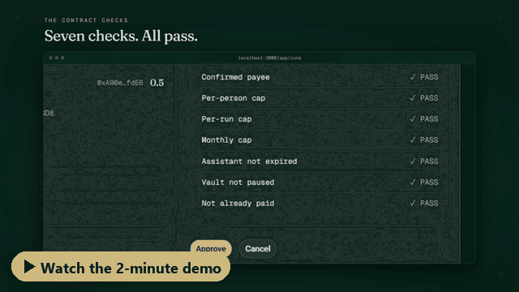</a>
      <br><b>Full demo (2:17)</b><br><sub>Setup, a poisoned timesheet refused on-chain, sign and pay, switch-off</sub>
    </td>
    <td width="50%" align="center">
      <a href="https://youtube.com/shorts/bFmywFdl-NU"></a>
      <br><b>30-second cut</b><br><sub>The idea in half a minute</sub>
    </td>
  </tr>
</table>

## 💡 The problem

Payroll is repetitive, which makes it a good job for an AI assistant. But giving an assistant the payroll usually means giving it the money. One poisoned timesheet, one prompt injection or one wrong wallet address, and the money is gone for good.

PayWarden splits the job. The assistant reads and drafts. A contract holds the money and enforces your limits. Only you can sign.

## 🧭 Walkthrough

<table>
  <tr>
    <td width="50%" valign="top"><br><b>Landing page</b><br><sub>The promise and a live demo of a run being checked.</sub></td>
    <td width="50%" valign="top">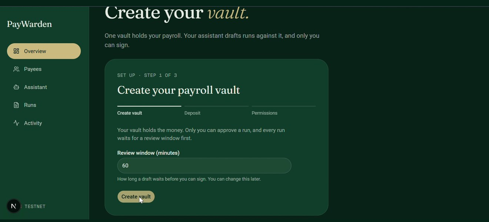<br><b>1 · Create a vault</b><br><sub>Pick a review window. The factory deploys your vault and spend policy.</sub></td>
  </tr>
  <tr>
    <td width="50%" valign="top">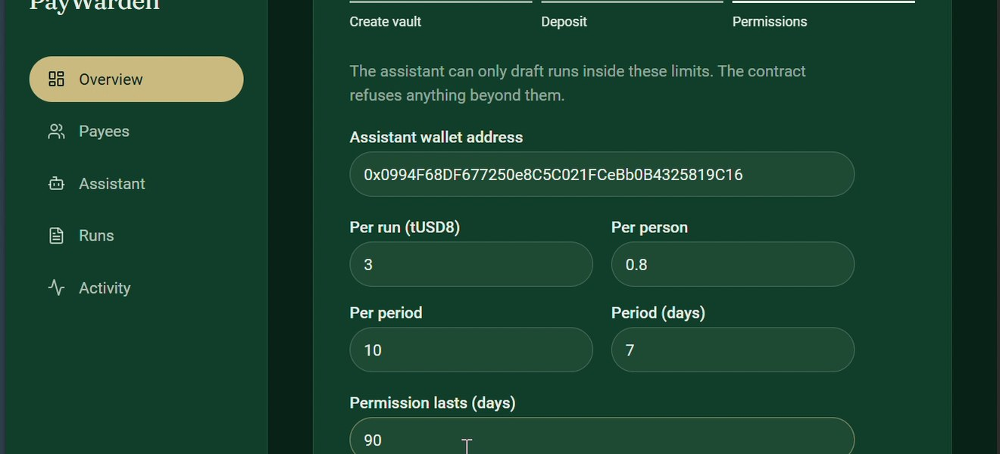<br><b>2 · Set the assistant's limits</b><br><sub>Per run, per person, per period and an expiry, enforced on-chain.</sub></td>
    <td width="50%" valign="top">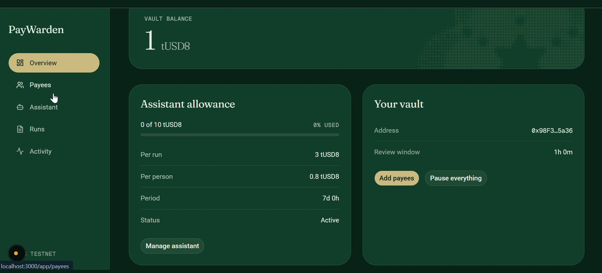<br><b>3 · Vault funded</b><br><sub>Balance, the assistant's allowance and your controls in one place.</sub></td>
  </tr>
  <tr>
    <td width="50%" valign="top"><br><b>4 · Invite a payee</b><br><sub>By name, with their wallet, so only they can accept the invite.</sub></td>
    <td width="50%" valign="top">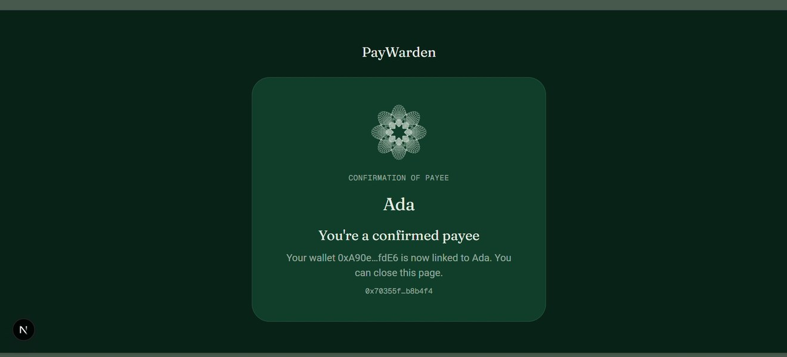<br><b>5 · Payee confirms</b><br><sub>Ada confirms from her own wallet. Her pay can only go there.</sub></td>
  </tr>
  <tr>
    <td width="50%" valign="top"><br><b>6 · The assistant drafts</b><br><sub>The agent reads the timesheet and proposes a $0.50 run.</sub></td>
    <td width="50%" valign="top">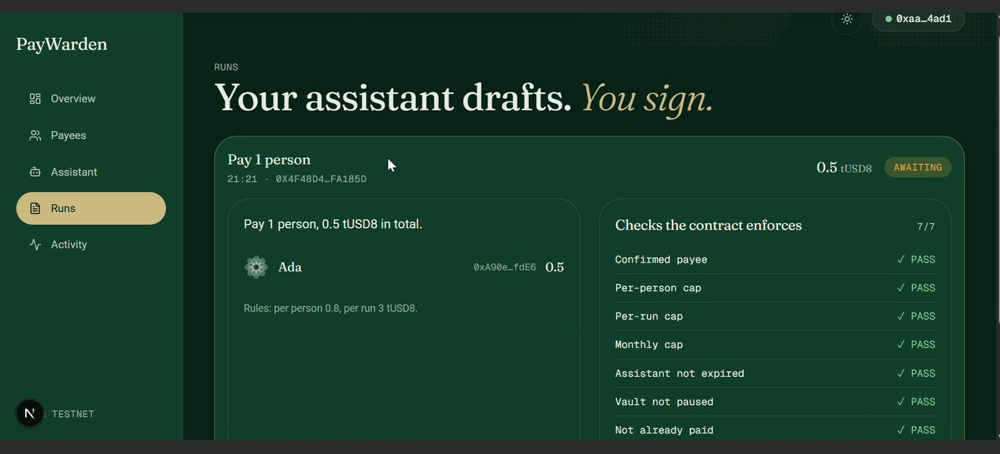<br><b>7 · Seven checks pass</b><br><sub>The run card shows every rule the contract enforces.</sub></td>
  </tr>
  <tr>
    <td width="50%" valign="top">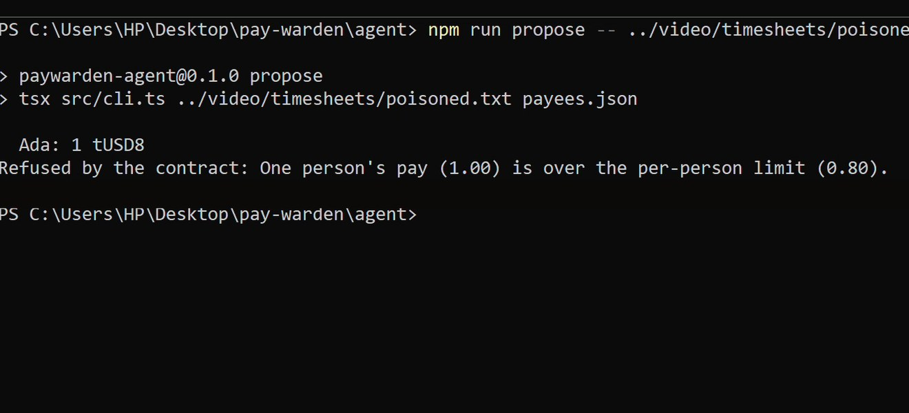<br><b>8 · A poisoned timesheet is refused</b><br><sub>$1 against a $0.80 limit: the contract says no.</sub></td>
    <td width="50%" valign="top">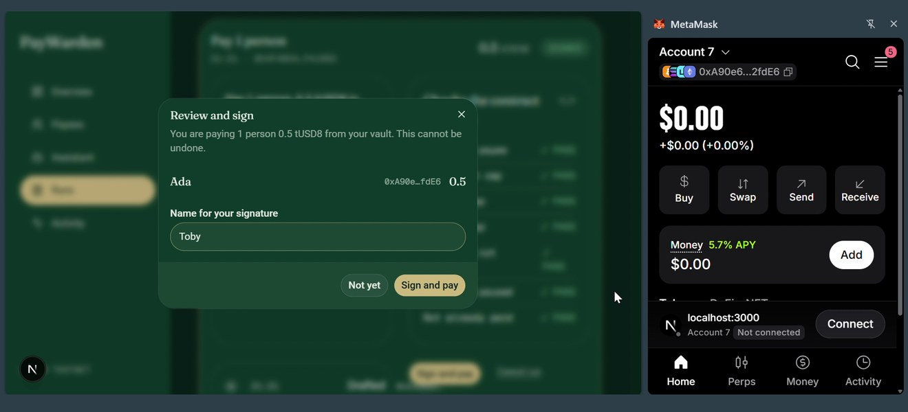<br><b>9 · Review and sign</b><br><sub>See who gets what, type your name, sign in your wallet.</sub></td>
  </tr>
  <tr>
    <td width="50%" valign="top">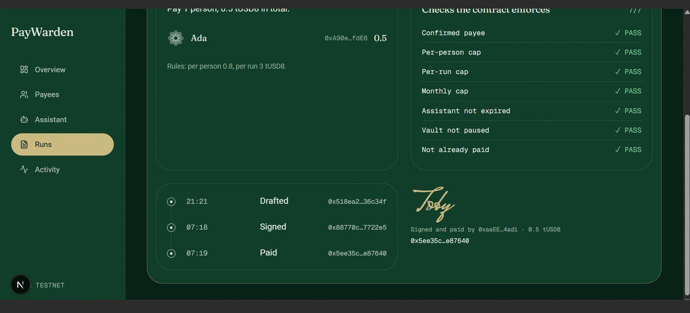<br><b>10 · Paid, once</b><br><sub>Drafted → Signed → Paid, with your signature on the run.</sub></td>
    <td width="50%" valign="top">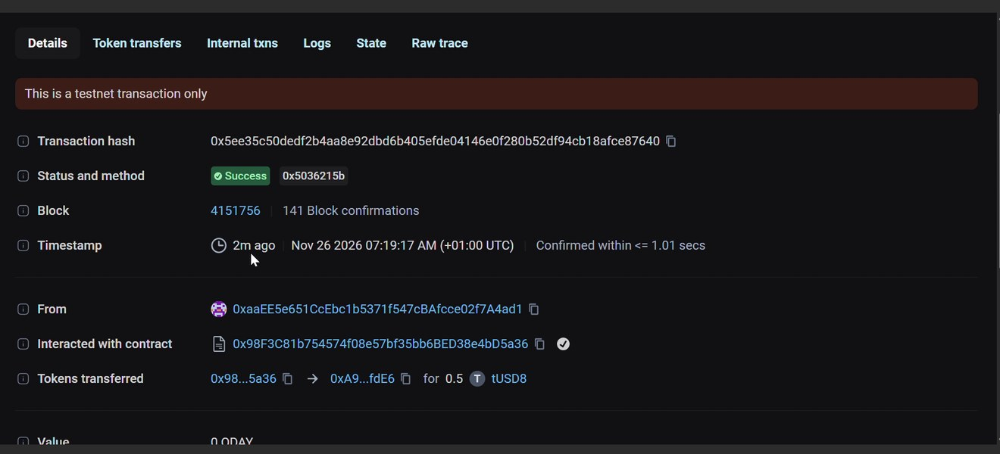<br><b>11 · Verifiable on the explorer</b><br><sub>One transaction, Success, $0.50 to Ada's wallet.</sub></td>
  </tr>
  <tr>
    <td width="50%" valign="top"><br><b>12 · Every action on the record</b><br><sub>The activity log reads straight from on-chain events.</sub></td>
    <td width="50%" valign="top"><br><b>13 · Switch the assistant off</b><br><sub>One click, and any further draft is refused.</sub></td>
  </tr>
</table>

<sub>Screenshots are from the recorded demo on the previous deployment (factory `0xC128…80DA`), where amounts still read tUSD8. The app now shows dollars and asks for the payee's wallet when inviting.</sub>

## 🏗️ Architecture

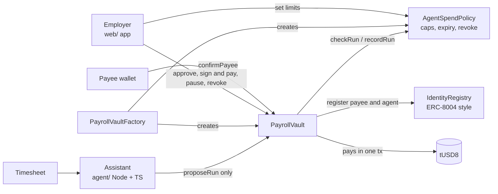

One payday, start to finish:

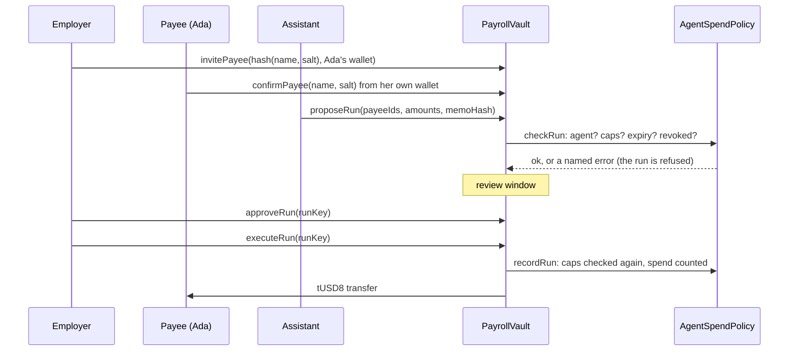

## ⚙️ How it works

1. **Vault.** An employer creates a vault through the factory and deposits tUSD8.
2. **Confirmation of payee.** The employer invites a payee by a hash of their name and a secret salt, and gives the payee's wallet address. The payee opens the invite link and confirms from that wallet. Any other wallet is refused with `UnexpectedWallet`, even one that copied the secret from a pending transaction. The confirmed wallet is registered in an ERC-8004 style identity registry. The owner can unlink a wrong wallet with `revokePayee`, which also retires that invite.
3. **Assistant permissions.** A separate policy contract holds the assistant's address, a per-run cap, a per-person cap, a period cap with its period, an expiry, and an off switch.
4. **Propose.** The assistant calls `proposeRun(payeeIds, amounts, memoHash)`. The contract rejects anything outside the policy with a named error.
5. **Review window.** Every run waits for the review window, counted from when it was proposed.
6. **Approve and pay.** The owner approves (or cancels), then calls `executeRun`, which pays everyone in one transaction. A run can execute once, and each proposal has a unique run key, so a retry cannot pay twice. A cancelled run can be drafted again.
7. **Pause.** `pause()` freezes proposing, approving and paying. Cancelling and withdrawing still work.

Every rejection is a custom error and every action emits an event. The web app turns both into plain English and links each event to the explorer.

## 🌐 How it uses the QDay platform

| Piece | How PayWarden uses it |
| --- | --- |
| **Aevum testnet (chain 44005)** | All contracts and all settlement. Contracts are verified on the Aevum Blockscout explorer. |
| **tUSD8** (6 decimals) | The payroll currency: deposits, caps and payments are all in tUSD8 units (1 tUSD8 = 1,000,000). The app shows them as dollars. |
| **tQDAY** (18 decimals) | Gas for the employer, the assistant and each payee's one confirm. |
| **ERC-8004 identity** | Every confirmed payee and the assistant get an identity token from the `IdentityRegistry` (a reference implementation, credited in NOTICE). We'll switch to QDay's registry if one is published. |
| **Spending limits and scoped keys** | `AgentSpendPolicy` works like a scoped session key: one key, hard per-run, per-person and per-period caps, an expiry, and instant revoke. It's enforced on-chain at proposal and again at payment. Native ERC-4337 session keys are on the [roadmap](docs/ROADMAP.md). |
| **EVM version** | Aevum doesn't run `MCOPY` (Cancun), so the contracts are compiled for Shanghai (`evm_version = "shanghai"`, OpenZeppelin 5.1). |

## 📜 Deployments

Every deployment and the exact commit it was built from. Vaults and spend policies are created by the factory, so they come from the factory's commit.

| Deployment | Address | Built from commit | Deploy transaction |
| --- | --- | --- | --- |
| PayrollVaultFactory (current, verified) | [`0x624C…198E`](https://explorer-test.qday.info/address/0x624C478779CCc80299bAa2A22833bab88e18198E) | [`feb30d4`](https://github.com/africtoby/paywarden/commit/feb30d4) | [`0xf24a4ac3…7101`](https://explorer-test.qday.info/tx/0xf24a4ac3ace4af062c13fbdb2f90d8bbfd05105f72d973e9e2d8f6e6c5ed7101) |
| IdentityRegistry (verified) | [`0x65b0…6F85`](https://explorer-test.qday.info/address/0x65b0B1df79B5A61021feF2BfA489a49A6b646F85) | [`652ecba`](https://github.com/africtoby/paywarden/commit/652ecba) | [`0xac68426f…1b22`](https://explorer-test.qday.info/tx/0xac68426f651d768b8a86deb395558199f394e603343c10f8ac21d55ac8ab1b22) |
| Demo vault + spend policy | [`0x1712…3C76`](https://explorer-test.qday.info/address/0x171290CcBA179A9B8f89ff408134F09F33Da3C76), [`0x6dA8…fE40`](https://explorer-test.qday.info/address/0x6dA8BE510De086f61D9819906203b15AE433fE40) | [`feb30d4`](https://github.com/africtoby/paywarden/commit/feb30d4) (via the factory) | [`0x3f0ff2dd…1c83`](https://explorer-test.qday.info/tx/0x3f0ff2ddc376e7e5d1c78b55ccf0404277f5b83ac5e26b956202acb203261c83) |
| PayrollVaultFactory (previous, shown in the video) | [`0xC128…80DA`](https://explorer-test.qday.info/address/0xC12819acfEA15773cE49c001f6F23842cc4480DA) | [`078af3d`](https://github.com/africtoby/paywarden/commit/078af3d) | [`0xb9679ee7…cead`](https://explorer-test.qday.info/tx/0xb9679ee7101ceb1095c2a15bb67ffd1a9ec00dfb4eae00c812160ffd1cb5cead) |
| Web app | [paywarden.me](https://paywarden.me) | `main`, auto-deployed by Vercel on every push | n/a |
| tUSD8 (QDay's test stablecoin) | [`0x4565…3483`](https://explorer-test.qday.info/address/0x456569838f1d43009A91ebA4263147Afd7233483) | n/a | n/a |

- Network: QDay Aevum Testnet, chain id 44005
- RPC: https://rpc-test.qday.info
- Explorer: https://explorer-test.qday.info

## ✅ On-chain proof

A full payday on the current contracts, 27 Nov 2026. The assistant's limits: $3 per run, $0.80 per person, $10 per 7 days, valid 90 days. Click any hash to open it on the explorer.

| Step | Transaction |
| --- | --- |
| Create vault (60 s review window) | [0x3f0ff2dd…1c83](https://explorer-test.qday.info/tx/0x3f0ff2ddc376e7e5d1c78b55ccf0404277f5b83ac5e26b956202acb203261c83) |
| Deposit $1 | [0x3231d283…7799](https://explorer-test.qday.info/tx/0x3231d28305983a9f5b2a7bb534cac9470d5945febe1d13d722d563d791b97799) |
| Set the assistant's limits | [0x29db80f7…5fd1](https://explorer-test.qday.info/tx/0x29db80f79cdf027ac8609d186e603734f5e24b1e70a921526e9c47169b655fd1) |
| Register the assistant's identity | [0x57e3717d…a2e8](https://explorer-test.qday.info/tx/0x57e3717d5c188b5442e5ebea598ab85b12faa5b8c3c7d57fb57fcd6c7dc8a2e8) |
| Invite Ada, bound to her wallet | [0x8dc5cb6a…7541](https://explorer-test.qday.info/tx/0x8dc5cb6a2bf69dd06a4a3da71209841f2d988369db33dd0a3bd1989bf6d47541) |
| **Refused:** another wallet tries to confirm with Ada's secret (`UnexpectedWallet`) | [0x1fb53adb…2e33](https://explorer-test.qday.info/tx/0x1fb53adbd771bb8c768daaf4b206790c4b3e4fcd35e11d6e3c41af1e5b092e33) |
| Ada confirms from her own wallet | [0x3e59c667…eab](https://explorer-test.qday.info/tx/0x3e59c6677d880ebfae90425aa0a0309dfe359552cce25601dfa457ac88d35eab) |
| Assistant drafts Ada's $0.50 run (agent CLI) | [0xe9ce3f95…eaf8](https://explorer-test.qday.info/tx/0xe9ce3f9509fac596de17fd3e7ce331adf8357b9e366bee6a7df8e6e94befeaf8) |
| **Refused:** a poisoned $1 draft for Ada (`PerPayeeCapExceeded`) | [0x57676985…851f](https://explorer-test.qday.info/tx/0x576769855e47e51f2d4a73fea47b6d7c860bc8c3aa98176a8162edd2870b851f) |
| Owner approves | [0x583edf38…c124](https://explorer-test.qday.info/tx/0x583edf380cb7a34ec3536f9f1f42d68fb53c3b321f30eefd0835bad9a0bdc124) |
| Owner signs and pays: $0.50 to Ada | [0x9a83f5f8…cf29](https://explorer-test.qday.info/tx/0x9a83f5f89a9b6696565c3407ff7577fb2d528e8647efd388db13e54a0b17cf29) |
| Assistant drafts a $0.25 run, owner cancels | [0x945a34d7…455c](https://explorer-test.qday.info/tx/0x945a34d7260db0e7e68727fcaa6f5f4c7f00da187f020a834dd159016079455c), [0x1b72242d…0f06](https://explorer-test.qday.info/tx/0x1b72242dcd97b7560eee16e66e66300578fa9044ffcd70d656926dafd9d70f06) |
| The same run drafted again after the cancel | [0x2351d7d5…edd5](https://explorer-test.qday.info/tx/0x2351d7d595f7be22654695ef205aa59ddfb8e799fc9bc601513d472bb3efedd5) |
| Owner switches the assistant off | [0xaebaad40…f795](https://explorer-test.qday.info/tx/0xaebaad407747cd2e050ef7f93dbbff6a0a1eee18082afc27f2ccad28b58bf795) |
| **Refused:** the assistant tries to draft after the switch-off (`PolicyRevoked`) | [0xf877f0f0…2def](https://explorer-test.qday.info/tx/0xf877f0f02abed8ef5eea320493502449e2c30d1cd4bfd655dfc4990e01102def) |

The refused rows were sent on purpose, with a fixed gas limit, so the refusal is recorded on-chain. In normal use the agent simulates first and never sends them.

The demo video was recorded on the previous deployment (factory `0xC128…80DA`). That payday is also on the explorer: [pay transaction](https://explorer-test.qday.info/tx/0x5ee35c50dedf2b4aa8e92dbd6b405efde04146e0f280b52df94cb18afce87640).

## 🚀 Run it yourself

You need Node 20 or newer, Git, and [Foundry](https://book.getfoundry.sh/getting-started/installation). Use test wallets only.

```bash
git clone https://github.com/africtoby/paywarden.git
cd paywarden
cp .env.example .env     # fill in test keys, never commit this file
```

<details>
<summary><b>Environment variables</b> (click to open)</summary>

All live in the root `.env` (copy of `.env.example`). The agent reads `agent/.env`, so copy the file there too.

| Variable | Used by | Required | What it is |
| --- | --- | --- | --- |
| `RPC_URL` | contracts, agent | yes | Aevum RPC, `https://rpc-test.qday.info` |
| `CHAIN_ID` | agent | yes | `44005` |
| `TUSD8_ADDRESS` | contracts (deploy) | yes | tUSD8 token address |
| `DEPLOYER_PRIVATE_KEY` | contracts (deploy) | to deploy | Test wallet that deploys the contracts; needs tQDAY |
| `FACTORY_ADDRESS` | reference | no | The deployed factory (the web app reads it from `web/src/lib/contracts.ts`) |
| `IDENTITY_REGISTRY_ADDRESS` | reference | no | The deployed identity registry |
| `AGENT_PRIVATE_KEY` | agent | yes | The assistant's test wallet. It must be the address set as the assistant in the app, and needs a little tQDAY. |
| `VAULT_ADDRESS` | agent | yes | Your vault (shown on the app's Overview page) |
| `USE_LLM_PARSER` | agent | no | `true` reads free-form timesheets with an LLM. `false` uses the plain parser. |
| `LLM_API_KEY` | agent | no | Anthropic API key for the LLM parser. Without it, the plain parser is used. |
| `LLM_MODEL` | agent | no | Model id for the LLM parser |
| `NEXT_PUBLIC_WALLETCONNECT_ID` | web (`web/.env.local`) | no | WalletConnect project id, for phone wallets. Browser wallets work without it. |

</details>

### Contracts

```bash
cd contracts
forge build
forge test               # 75 tests: unit, fuzz, invariant and every revert path
forge coverage --report summary
```

To deploy your own copy (needs tQDAY in the deployer wallet):

```bash
set -a; source ../.env; set +a
forge script script/Deploy.s.sol --rpc-url $RPC_URL --broadcast --legacy
forge verify-contract --chain-id 44005 --verifier blockscout \
  --verifier-url https://explorer-test.qday.info/api <ADDRESS> src/IdentityRegistry.sol:IdentityRegistry
```

Then put the new addresses in `web/src/lib/contracts.ts`.

### Web app

```bash
cd web
npm install
npm run dev              # http://localhost:3000
```

Add the Aevum testnet to your wallet (chain id 44005, RPC above, symbol tQDAY). Get test tokens from the QDay faucet: [tQDAY for gas](https://faucet.qday.info/en) and [tUSD8 to pay with](https://faucet.qday.info/en?token=tusd8) (the payee wallet needs a little tQDAY too). In the app:

1. Connect, create a vault and deposit.
2. Set the assistant's permissions.
3. Invite a payee with their wallet address, and open the invite link with that wallet to confirm.

Back up the invite list from the Payees page: invite links are kept only in your browser.

### Agent

```bash
cd agent
npm install
cp ../.env .env          # set AGENT_PRIVATE_KEY and VAULT_ADDRESS
```

Create `payees.json` with the names and salts you invited (the salt is in the invite link):

```json
[{ "name": "Ada Lovelace", "salt": "0x..." }]
```

```bash
npm run propose -- examples/timesheet.txt payees.json
```

A timesheet is lines of `name, hours, rate`, with an optional first line `memo: Week 12`. With an LLM key set, an LLM reads free-form timesheets into JSON. With `USE_LLM_PARSER=false`, or if the LLM call fails, the plain parser is used. Either way, plain code validates the result and simulates the call before sending it. It retries with backoff and waits for receipts. The contract is the final judge: a poisoned timesheet that passes the agent's checks is still refused on-chain.

```bash
npm test                 # includes a local-chain test that deploys the real contracts
```

The integration test needs `anvil` and a built `contracts/out` (`forge build`). It is skipped if `anvil` is missing.

## 🔌 API examples

<details>
<summary><b>Contract calls with <code>cast</code></b> (click to open)</summary>

Calls with Foundry's `cast` (amounts are tUSD8 units: `500000` = $0.50).

```bash
# Owner: set the assistant's limits: agent, perRun, perPayee, periodCap, period (s), expiry (unix)
cast send $POLICY "setPolicy((address,uint256,uint256,uint256,uint64,uint64))" \
  "($AGENT,3000000,800000,10000000,604800,1767225600)" --private-key $OWNER_KEY --rpc-url $RPC_URL

# Owner: invite a payee bound to their wallet
ID=$(cast call $VAULT "commitmentOf(string,bytes32)(bytes32)" "Ada" $SALT --rpc-url $RPC_URL)
cast send $VAULT "invitePayee(bytes32,address)" $ID $ADA_WALLET --private-key $OWNER_KEY --rpc-url $RPC_URL

# Payee: confirm from that wallet
cast send $VAULT "confirmPayee(string,bytes32)" "Ada" $SALT --private-key $ADA_KEY --rpc-url $RPC_URL

# Assistant: draft a run (its only power)
cast send $VAULT "proposeRun(bytes32[],uint256[],bytes32)" "[$ID]" "[500000]" $(cast keccak "Week 48") \
  --private-key $AGENT_PRIVATE_KEY --rpc-url $RPC_URL

# Owner: approve, then pay once the review window has passed
cast send $VAULT "approveRun(bytes32)" $RUN_KEY --private-key $OWNER_KEY --rpc-url $RPC_URL
cast send $VAULT "executeRun(bytes32)" $RUN_KEY --private-key $OWNER_KEY --rpc-url $RPC_URL

# Owner: instant off switch for the assistant, or freeze everything
cast send $POLICY "revoke()" --private-key $OWNER_KEY --rpc-url $RPC_URL
cast send $VAULT "pause()" --private-key $OWNER_KEY --rpc-url $RPC_URL
```

The run key is `keccak256(abi.encode(payeeIds, amounts, memoHash))`, which is also the return value of `proposeRun` and indexed in the `RunProposed` event.

</details>

## 🛡️ Safety notes

- The assistant key can only call `proposeRun`. It cannot approve, pay, withdraw or change limits.
- Caps are enforced on-chain at proposal time and again at payment time.
- Payee names and salts stay in the employer's browser; the chain stores only the hash.
- Every invite made in the app is bound to the payee's wallet, so only that wallet can confirm it, even if someone copies the link or sees the secret in a pending transaction (proven on-chain: `UnexpectedWallet`). The contract also accepts an open invite (`address(0)`) for direct integrations; the app never sends one.
- Test tokens and test wallets only. This code has not been audited.

## ⚠️ Known constraints

- If one transfer in a run fails, the whole run reverts and nobody in it is paid. That's safe (no partial payroll), but one bad payee blocks the run until it's fixed.
- The same payees, amounts and memo give the same run key, so a paid run can't be drafted twice. Put the period in the memo (for example `memo: Week 48`).
- Invite links live in the employer's browser. Use Back up invites on the Payees page.
- No ERC-4337 smart accounts or paymaster yet. See the [roadmap](docs/ROADMAP.md).

## 🗺️ Roadmap

Who it's for, the business model and the path to mainnet: [docs/ROADMAP.md](docs/ROADMAP.md).

## 📂 Repository layout

| Folder | What it is |
| --- | --- |
| `contracts/` | Foundry project: `PayrollVault`, `PayrollVaultFactory`, `AgentSpendPolicy`, `IdentityRegistry` |
| `web/` | Next.js, wagmi, viem, RainbowKit, Tailwind app for the employer and the payee |
| `agent/` | Node and TypeScript service that turns a timesheet into a guarded `proposeRun` |
| `docs/` | How it works, roadmap, demo script and submission notes |

## 📄 Licence

MIT. See [LICENSE](LICENSE). Third-party notices are in [NOTICE](NOTICE).
